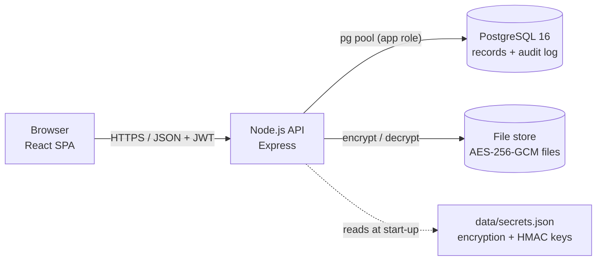

# EvidenceVault Rwanda — Implementation Plan

Nov 21, 2026

## Overview

EvidenceVault Rwanda will ship as a working web prototype by 1 March 2027, built with Node.js, Express, PostgreSQL and React. The work runs in seven phases: three for the backend, two for the React frontend, then testing, and documentation with the demo.

The prototype lets authorized users register digital evidence, verify that files have not changed, transfer custody, and produce a chain-of-custody report. Every action is written to a tamper-evident audit log.

**In scope for the prototype**

- Sign-in with role-based access for four roles: administrator, investigator, evidence custodian, auditor
- Case management with case-level access for investigators
- Evidence upload with SHA-256 hashing at intake and AES-256-GCM encryption at rest
- On-demand integrity checks, plus automatic checks before every download and report
- Custody transfers that the receiver must accept
- Keyed (HMAC) hash-chained, append-only audit log with a one-click chain check
- Alerts for integrity failures, denied access and account lockouts
- Printable chain-of-custody report

**Out of scope for the prototype** (see the hardening roadmap): integration with RIB or court systems, mobile apps, cloud key management, and legal certification of the system.

## Architecture and technology stack

The system is a React single-page app talking to a Node.js API, which keeps records in PostgreSQL and evidence files encrypted on disk.

### Keys and secrets

`data/secrets.json` holds three secrets: the file-encryption key, the audit-log HMAC key and the JWT signing secret. It lives outside the database and file store and must be backed up separately.

- The file is created once, with `npm run keygen`. The server never generates keys on its own.
- On start-up the server refuses to run if `secrets.json` is missing while evidence rows exist. A lost key must never be replaced silently by a new one.
- Each evidence row records the `key_id` it was encrypted with, so the key can be rotated later without losing older files.

| Layer | Technology | Why |
| --- | --- | --- |
| Frontend | React 18, Vite, React Router | Fast development, simple routing; React 18 chosen for library compatibility |
| API | Node.js 22 LTS, Express 4 | Same language as the frontend; supported LTS release |
| Database | PostgreSQL 16 via node-postgres (pg) | Many concurrent users, transactions and row locks, database-level roles |
| Uploads | multer | Standard multipart handling for Express |
| Authentication | jsonwebtoken, bcryptjs | Signed tokens, salted password hashes |
| Cryptography | Node.js crypto module | SHA-256, HMAC-SHA256 and AES-256-GCM with no extra dependencies |
| Testing | Jest, Supertest | API tests written alongside each backend phase |

## Data model

Seven PostgreSQL tables hold all state; evidence files themselves live encrypted on disk, outside the database.

| Table | Purpose | Key fields |
| --- | --- | --- |
| users | Accounts and roles | full\_name, email, password\_hash (bcrypt), role, active, failed\_logins, locked\_until |
| cases | Investigations that group evidence | case\_number, title, status (open/closed), created\_by |
| case\_members | Which investigators may access which case | case\_id, user\_id |
| evidence | One row per registered file | evidence\_code (EV-2026-000001), case\_id, original\_name, size\_bytes, sha256 (of the original file), ciphertext\_sha256 (of the stored file), storage\_name, key\_id, iv, auth\_tag, collection\_metadata (JSONB), current\_custodian\_id, integrity\_status, last\_verified\_at |
| custody\_transfers | Requests to hand evidence to another person | evidence\_id, from\_user\_id, to\_user\_id, reason, status (pending/accepted/rejected); at most one pending transfer per item (partial unique index) |
| audit\_log | Append-only record of every action | seq, timestamp, user\_id, action, entity, details, ip, prev\_hash, entry\_hash (HMAC-SHA256) |
| alerts | Security events for administrators | severity, type, message, evidence\_id, acknowledged |

### How the audit log is protected

Four rules protect the record:

1. **Triggers.** Row triggers reject any UPDATE or DELETE on audit\_log, and a statement trigger rejects TRUNCATE.
2. **Database roles.** Migrations run as an owner role. The API connects as a separate app role that has only INSERT and SELECT on audit\_log.
3. **Keyed hash chain.** Each entry's `entry_hash` is an HMAC-SHA256, keyed from `secrets.json`, over the previous entry's hash and the entry's own fields. Someone who edits the database without the key cannot recompute the chain, so editing an old entry breaks it from that point on.
4. **Anchored head.** Every chain-of-custody report prints the current chain head (latest `seq` and `entry_hash`). The chain check also compares the head with the last anchored value, so deleting the newest entries is detected too.

The hash covers one canonical string the API builds: the timestamp as ISO-8601 to the millisecond, then the other fields, with the JSON `details` keys sorted. The timestamp is stored at millisecond precision, so the value read back from the database always reproduces the same hash.

Each audit append takes a transaction-level advisory lock, so two simultaneous actions cannot both link to the same previous entry. Timestamps use TIMESTAMPTZ.

The API never returns storage\_name, key\_id, iv or auth\_tag to the browser.

## Roles and permissions

Auditors can inspect everything but never download a file; investigators see only the cases they are assigned to.

| Action | Administrator | Investigator | Custodian | Auditor |
| --- | --- | --- | --- | --- |
| Create cases, add members | Yes | Yes (own cases) | No | No |
| Register evidence | Yes | Yes (assigned cases) | No | No |
| View evidence and history | All | Assigned cases | All | All |
| Verify integrity | Yes | Assigned cases | Yes | Yes |
| Download original file | Yes | Assigned cases | Yes | No |
| Request custody transfer | Any item (reason required, logged as CUSTODY\_REASSIGNED) | Items they hold | Items they hold | No |
| Accept or reject transfer | If recipient | If recipient | If recipient | No |
| Generate custody report | Yes | Assigned cases | Yes | Yes |
| View audit log, check chain | Yes | No | No | Yes |
| View alerts | Yes | No | No | Yes |
| Acknowledge alerts, manage users | Yes | No | No | No |

Access rules:

- Every refused action is logged as ACCESS\_DENIED and raises a warning alert.
- Five failed sign-ins lock an account for 15 minutes.
- On every request, the API reads the user's `active` flag and role from the database instead of trusting the token. A deactivated user or changed role takes effect immediately.
- **Closed cases are read-only.** Evidence and history can still be viewed, verified, downloaded and reported, but nobody can register new evidence or request transfers.
- **Duplicate-file warnings** name the existing item only when the uploader may see it. Otherwise they say only that a matching file is already registered.

## Implementation phases

The work runs in seven phases, three for the backend first. Each phase ends with something you can run and show, and each backend phase adds its own Jest and Supertest tests.

### Phase 1. Backend foundation

- [x] Express server, folder structure, configuration from .env
- [x] PostgreSQL 16 with Docker Compose; init script creates the migration owner role and the app role; DATABASE\_URL in .env
- [x] Schema as versioned SQL migrations (node-pg-migrate): users, cases, case\_members, audit\_log, alerts
- [x] Minimal `audit.append()` and `alerts.raise()` helpers, so later code can log from day one
- [x] Sign-in with JWT, bcrypt password hashing, account lockout (logged and alerted)
- [x] Auth middleware that re-reads `active` and role on each request; role middleware and case-level access checks (ACCESS\_DENIED logged)
- [x] User management and case routes; seed script for demo accounts
- [x] Jest and Supertest set up against a test database reset on each run; tests for sign-in, lockout and case access

Done early, ahead of later phases: `npm run keygen`, with the server refusing to start without `secrets.json` (the "evidence exists" check comes in Phase 2); the HMAC chain with millisecond timestamps, sorted JSON and the advisory lock (Phase 3 still adds chain verification, the triggers and the head anchor); and INSERT and SELECT as the app role's only privileges on audit\_log.

Deliverable: a user can sign in and create a case. The Phase 1 tests pass.

### Phase 2. Evidence intake and integrity

- [x] `npm run keygen` creates `data/secrets.json`; the server refuses to start if the key is missing while evidence exists
- [x] Evidence table migration
- [x] Upload with multer (100 MB limit); SHA-256 of the original computed before storage
- [x] AES-256-GCM encryption at rest with `key_id`; files written read-only; SHA-256 of the stored file recorded
- [x] Evidence codes (EV-YYYY-NNNNNN) and a duplicate-file warning limited to items the user may see
- [x] Integrity check endpoint, also run automatically before download and report: it re-hashes the stored file, then decrypts and re-hashes the original; a GCM authentication failure counts as Failed
- [x] Download blocked when a check fails; closed cases refuse new evidence
- [x] Tests for upload, verification, a tampered file, a missing file and the key start-up check

Notes: the integrity check is a reusable service, so the Phase 3 report endpoint only needs to call it. The app database role can update only `integrity_status`, `last_verified_at` and `current_custodian_id` on evidence, so recorded hashes and keys cannot be changed through the API.

Deliverable: upload a file, verify it, and watch a tampered copy fail the check. The Phase 2 tests pass.

### Phase 3. Custody, audit and alerts

- [x] Migration for custody\_transfers, including the one-pending-transfer-per-item index
- [x] Custody transfer request, accept and reject, each inside a transaction; accept locks the evidence row (`SELECT … FOR UPDATE`) and re-checks the current custodian
- [x] Admin reassignment needs a reason and is logged as CUSTODY\_REASSIGNED; closed cases refuse transfers
- [x] HMAC hash chain with canonical serialization, an advisory lock on appends, and chain verification
- [x] UPDATE/DELETE row triggers and a TRUNCATE statement trigger on audit\_log; grant the app role only INSERT and SELECT on it
- [x] Alerts for integrity failure, denied access and lockouts
- [x] Chain-of-custody report endpoint (prints the chain head) and dashboard counts
- [x] Tamper scripts for the demo (file and audit log)
- [x] Tests for custody rules, concurrent accepts, chain verification and both tamper scenarios
- [ ] Saved Postman collection (`backend/requests.http` covers the same requests for the VS Code REST Client)

Notes:

- **Reasons and cancelling.** Every transfer needs a reason, not only admin reassignments. The requester, the holder or an administrator can cancel a pending transfer.
- **Anchors.** Anchors live in an `audit_anchors` table that is HMAC-signed and append-only. Both reports and successful chain checks anchor the head. The chain check validates every anchor, not just the latest, so a later report cannot cover up deleted entries.
- **Broken-chain alert.** A broken chain raises a critical AUDIT\_CHAIN\_BROKEN alert.

Deliverable: the full API works, shown through a saved Postman collection, including both tamper scenarios. All backend tests pass.

### Phase 4. Frontend core

- [ ] Vite and React setup, API client with token handling, route guards
- [ ] Sign-in page and app layout with role-aware navigation
- [ ] Dashboard: counts, transfers waiting for you, open alerts
- [ ] Case list, create case, case detail with members

Deliverable: a user can sign in, create a case and add members.

### Phase 5. Evidence screens

Screens are listed in priority order. If the phase runs late, cut from the bottom.

- [ ] Evidence detail with hash fingerprint, Verify button and result
- [ ] Register evidence form with file upload and collection metadata
- [ ] Download, custody transfer form and full history timeline
- [ ] Evidence list with search by code, title, case or hash
- [ ] Printable chain-of-custody report page
- [ ] Audit log page with Verify chain
- [ ] User management page (can be shown through the API instead)

Deliverable: the full evidence lifecycle works in the browser.

### Phase 6. Testing

- [ ] Fill gaps in the automated API tests so that every route is checked against every role
- [ ] Manual test scripts for each user role, run in the browser
- [ ] Every row of the Testing and demo plan table, run end to end
- [ ] Fix defects; retest

Deliverable: a test report with all cases passing.

### Phase 7. Documentation and demo

- [ ] README with setup steps (including `npm run keygen` and key backup) and demo accounts
- [ ] User guide for each role, with screenshots
- [ ] Architecture and API reference for the final report
- [ ] Rehearsed demo script (see Testing and demo plan)

Deliverable: project ready to present and hand in.

## Timeline

The seven phases take 14 weeks, from Monday 23 November 2026 to a demo-ready build on Monday 1 March 2027.

| Weeks | Dates | Work |
| --- | --- | --- |
| 1–2 | 23 Nov – 4 Dec 2026 | Phase 1. Backend foundation |
| 3–4 | 7 Dec – 18 Dec 2026 | Phase 2. Evidence intake and integrity |
| 5–6 | 21 Dec 2026 – 1 Jan 2027 | Holiday buffer |
| 7–8 | 4 Jan – 15 Jan 2027 | Phase 3. Custody, audit and alerts |
| 9–10 | 18 Jan – 29 Jan 2027 | Phase 4. Frontend core |
| 11–12 | 1 Feb – 12 Feb 2027 | Phase 5. Evidence screens |
| 13 | 15 Feb – 19 Feb 2027 | Phase 6. Testing |
| 14 | 22 Feb – 1 Mar 2027 | Phase 7. Documentation and demo |

The holiday buffer absorbs slippage from Phases 1 and 2. The frontend has no time buffer. Its risk is handled by the Phase 5 priority order: if Phase 5 runs late, cut from the bottom of its list, starting with the user management page.

## Testing and demo plan

The system passes when every row below behaves as expected; the demo walks through the same scenarios live.

| Area | Test | Expected result |
| --- | --- | --- |
| Sign-in | Five wrong passwords | Account locked 15 minutes, alert raised |
| Sign-in | Deactivate a signed-in user, then make a request | Refused at once; the old token stops working |
| Access | Investigator opens a case they are not assigned to | Refused, ACCESS\_DENIED logged, alert raised |
| Access | Auditor tries to download a file | Refused with 403 |
| Intake | Upload a file | SHA-256 recorded; stored file is encrypted and unreadable on disk |
| Intake | Upload the same file twice | Second upload warns of the duplicate |
| Intake | Register evidence on a closed case | Refused |
| Integrity | Verify an untouched file | Hashes match, status Verified |
| Integrity | Flip one byte in the stored file, then verify | Status Failed; recorded and current stored-file hashes shown; decryption authentication failed; critical alert |
| Integrity | Delete the stored file, then verify | Status Failed (file missing), critical alert |
| Integrity | Download a tampered file | Download blocked |
| Custody | Transfer to a custodian who accepts | Custodian changes; both steps in history |
| Custody | Non-custodian requests a transfer | Refused |
| Custody | Two users accept transfers of the same item at once | Only one succeeds |
| Audit | Edit one audit entry directly in the database, then check the chain | Chain reported broken at that entry |
| Audit | Edit an entry and recompute all later hashes with plain SHA-256 | Still detected, because the HMAC key is not in the database |
| Audit | Delete the newest audit entries, then check the chain | Detected: the chain head no longer matches the anchored value |
| Audit | TRUNCATE, UPDATE or DELETE on audit\_log as the app role | Refused by the database |
| Keys | Remove `secrets.json` and restart the server | Server refuses to start with a clear message |
| Report | Generate a report | Fresh integrity check, full history, chain head printed, printable |

**Demo script (about 10 minutes)**

1. Sign in as the investigator; create a case and register a screenshot as evidence.
2. Show the hash fingerprint and run Verify integrity.
3. Transfer custody to the custodian; sign in as the custodian and accept.
4. Run `npm run tamper:file` on the item; verify again and show the failure and the blocked download.
5. Sign in as the auditor; show the alert and the evidence history.
6. Run `npm run tamper:log`; click Verify chain and show where the chain breaks.
7. Generate and print the chain-of-custody report.

## Risks and production hardening

The biggest prototype risk is losing the encryption key, which makes every stored file unreadable.

| Risk | Impact | Mitigation |
| --- | --- | --- |
| Encryption key lost or deleted | All evidence unreadable | Back up data/secrets.json separately from the files; server refuses to start without it instead of creating a new key; document key recovery |
| Frontend takes longer than planned | Demo slips | Phase 5 screens in priority order, with the evidence detail page first and user management cut first |
| PostgreSQL not set up on the demo laptop | Setup blocked | One-command start with Docker Compose; native PostgreSQL 16 install as fallback; rehearse on the demo laptop |
| Large video files exhaust memory | Upload crashes | 100 MB limit in the prototype; streaming uploads in production |
| Someone with server access edits the database | Undetected change | HMAC chain cannot be recomputed without the key; chain head printed on every report; in production, also anchor the head externally each day |
| Someone locks out a user by guessing passwords on purpose | User cannot sign in for 15 minutes | Acceptable for the prototype; in production add per-IP rate limiting and lockout notices |

**Before any real deployment**

- Move the encryption and HMAC keys to a managed key service or hardware security module
- Move file storage to encrypted object storage; back up PostgreSQL off-site with point-in-time recovery
- Anchor the audit chain head externally every day, and keep backups of the audit log
- Serve only over HTTPS; add rate limiting, security headers (Helmet) and a content security policy
- Add two-factor authentication and short-lived sessions with refresh tokens
- Stream large uploads and hash them in chunks
- Sync the server clock with NTP, since timestamps form part of the evidence record
- Have an independent security review and penetration test
- Check compliance with Rwanda's data protection law (Law No. 058/2021) and the legal requirements for electronic evidence with RIB and legal advisers
